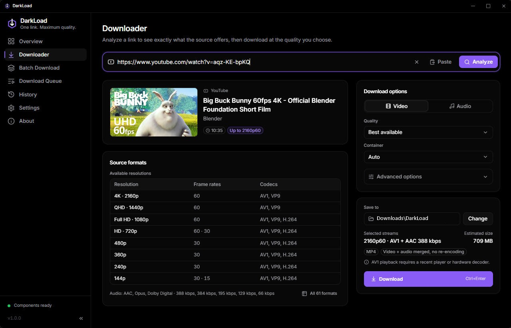
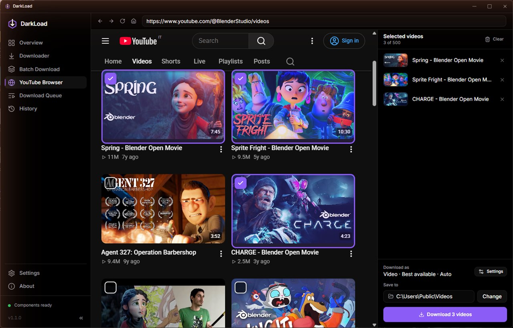
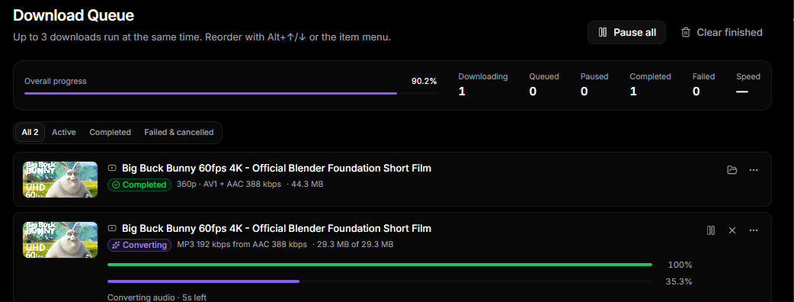
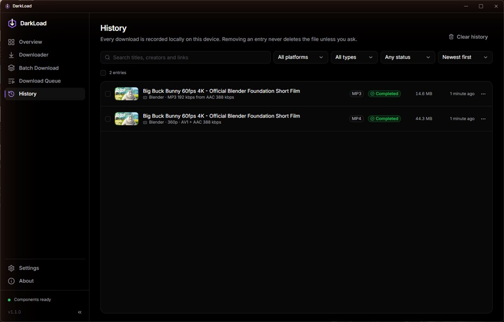
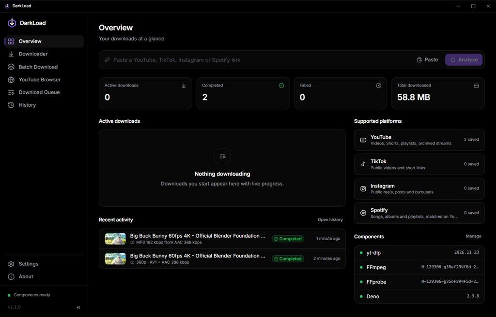
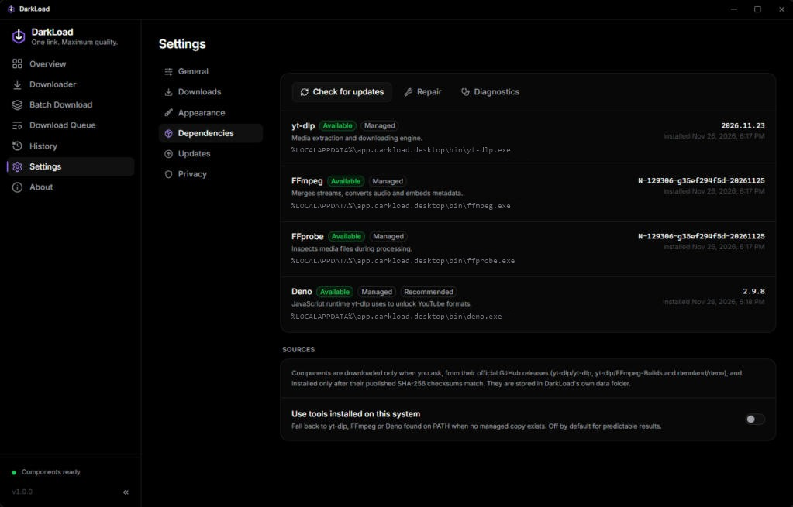

<p align="center">
  
</p>

<p align="center">
  A fast, privacy-focused desktop downloader for public YouTube, TikTok and Instagram media and Spotify songs,<br>
  at the highest quality the source actually offers.
</p>

<p align="center">
  <a href="../../releases/latest"><strong>Download</strong></a> ·
  <a href="#features">Features</a> ·
  <a href="#installation">Installation</a> ·
  <a href="docs/DEVELOPMENT.md">Development</a> ·
  <a href="CHANGELOG.md">Changelog</a>
</p>

---



## Why DarkLoad

Most downloaders guess. DarkLoad **inspects the formats a source offers**, shows you exactly what is available, and picks the best streams for the mode you choose. Video and audio streams are merged with FFmpeg **without re-encoding**, so the original resolution, frame rate, codec and dynamic range are preserved. When a container cannot hold the best streams, DarkLoad tells you and offers a container that can, instead of silently lowering quality. It never upscales or advertises quality the source does not have.

It is a native desktop application built with Tauri and Rust, with a pure-black OLED interface. DarkLoad works without accounts and has no telemetry, ads or cloud services.

## Features

**Quality**
- Best Available, Exact Resolution, Best Compatible (H.264 + AAC in MP4) and Custom format expressions.
- Resolutions from 144p up to 8K (4320p), original frame rates including 60 fps and above, HDR when offered.
- H.264, H.265/HEVC, VP9 and AV1, with an optional codec preference that never lowers resolution.
- MP4, MKV, WebM or automatic (the streams' natural container); conflicts are explained and resolved explicitly.
- Estimated file size when the source reports it.

**Audio**
- Original stream (no re-encoding), MP3, M4A, AAC, FLAC, WAV, Opus and OGG Vorbis.
- Best available or 320/256/192/128/96 kbps or a custom bitrate for lossy targets.
- Native streams are copied whenever possible; lossless containers come with an honest note that they cannot restore detail lost in a lossy source.
- Embedded cover art, title, artist or uploader and source metadata where the format supports it.

**Workflow**
- Downloader with clipboard paste, automatic platform detection and a live preview of the selected streams.
- YouTube Browser: browse YouTube inside DarkLoad, tick videos straight on their thumbnails (or select the one you are watching) and download every pick at once with the quality you choose.
- Batch Download: paste text, import a `.txt` file or drag and drop a list; duplicates are removed automatically; analyze many links in parallel and customize any item.
- Playlists and multi-video Instagram posts: pick individual entries or download all of them.
- Download Queue controlled by the Rust backend: configurable concurrency, real download speed and ETA, **separate merge and conversion progress measured from FFmpeg**, pause and resume, cancel, retry, automatic retries for network errors, reordering, desktop notifications, and persistence across restarts.
- History in a local SQLite database with search, filters, sorting, open file, show in folder, copy link, download again and safe removal (files are only deleted when you explicitly ask).
- Advanced options: subtitles (download, embed, languages, automatic captions), chapters, metadata, thumbnails, filename templates, duplicate handling and speed limits.

**Desktop experience**
- OLED-first design with an optional dark theme, accent color, density and animation preferences.
- Collapsible sidebar, custom title bar (or the system frame), remembered window size and position.
- Full keyboard navigation and shortcuts, reduced-motion support and accessible contrast.



| Queue with separate download and conversion progress | Local history |
| --- | --- |
|  |  |

| Overview | Managed components |
| --- | --- |
|  |  |

## Supported platforms

| Source | Supported content |
| --- | --- |
| YouTube | Videos, Shorts, playlists, archived livestreams, audio extraction |
| TikTok | Public videos, standard and shortened links (`vm.`/`vt.` and `/t/`), audio extraction |
| Instagram | Public reels, video posts and video carousels, audio extraction |
| Spotify | Songs, albums and playlists, saved as audio matched on YouTube |

DarkLoad can download public media without an account when the platform serves it to guests. If TikTok requests sign-in, DarkLoad also tries its public embedded player in an isolated guest session. Download only content you own or are authorized to save.

### Spotify

Spotify's audio is protected by DRM, and DarkLoad does not download it. For a Spotify link, DarkLoad reads the song's metadata from Spotify, searches YouTube for the same recording (comparing title, artists and duration and avoiding live versions, covers and remixes), downloads that audio and writes Spotify's title, artists, album, track number, release date and cover art into the file. The queue shows which YouTube upload was used. If no upload matches reliably, the song fails with a clear message instead of downloading something else.

- **Quality** is what YouTube offers, usually Opus or AAC at about 130–160 kbps. Converting to FLAC, WAV or 320 kbps MP3 does not restore detail.
- **Without an account**, metadata comes from Spotify's public player, which lists at most 100 songs of an album or playlist. To read longer playlists, create an app in the [Spotify Developer Dashboard](https://developer.spotify.com/dashboard) and enter its Client ID and Client Secret in Settings → Downloads. Spotify does not share its own editorial playlists with third-party apps, so those always use the public player.
- With the default filename template, songs are saved as `Artist - Title`.

## Installation

Download the latest version from the [Releases page](../../releases/latest). Every file name includes the version, operating system and architecture, and each release ships a `SHA256SUMS.txt`.

| System | Recommended | Alternatives |
| --- | --- | --- |
| Windows 10/11, x64 or ARM64 | `DarkLoad_<version>_windows_<arch>-setup.exe` | `.msi`, `_portable.zip` |
| Ubuntu, Debian and derivatives | `.deb` | `.AppImage`, `_portable.tar.gz` |
| Fedora, openSUSE | `.rpm` | `.AppImage` |
| Arch Linux and other distributions | `.AppImage` | `_portable.tar.gz` |

On first launch DarkLoad offers to install its components (yt-dlp, FFmpeg/FFprobe and Deno). They are downloaded from their official GitHub releases, verified against the published SHA-256 checksums, and stored in DarkLoad's own data folder. No Python or command-line setup is required.

### System requirements

- **Windows:** Windows 10 version 1809 or later, or Windows 11; Microsoft Edge WebView2 (preinstalled on current Windows; the installer fetches it if missing).
- **Linux:** a desktop with WebKitGTK 4.1 (Ubuntu 22.04+, Debian 12+, Fedora 38+, current Arch) and glibc. The `.deb` and `.rpm` packages pull these in automatically.
- About 250 MB of disk space for the application and components, plus space for your downloads.

## Privacy

DarkLoad has no telemetry, analytics, tracking, advertisements or cloud synchronization. It contacts the platforms you use, GitHub when you install or update components or check for app updates, and thumbnail servers for media you analyze. Clipboard monitoring is off by default. History, settings and the queue stay in a local SQLite database.

DarkLoad does not collect platform credentials or import browser sessions. The TikTok guest player uses a private webview and temporary guest cookies for its media requests. The YouTube Browser runs in a private, signed-out session with no access to DarkLoad's internals: it only opens YouTube pages, keeps no cookies or history after DarkLoad closes, and every video it reports is checked and turned back into a plain YouTube link by the backend.

## Development

```powershell
pnpm install
pnpm tauri dev
```

See [docs/DEVELOPMENT.md](docs/DEVELOPMENT.md) for prerequisites, architecture, testing and build instructions, and [docs/RELEASING.md](docs/RELEASING.md) for the release process and signing setup.

## Known limitations

- Public TikTok and Instagram posts are downloadable when the platform serves them to guests. If a post requires an account across the available guest routes, it is unavailable in DarkLoad.
- DarkLoad respects DRM, paywalls and other platform access controls. Instagram stories are outside the supported content types.
- Platforms change frequently. When extraction breaks, update yt-dlp from **Settings → Dependencies**.
- YouTube extraction relies on the Deno JavaScript runtime; without it fewer formats are available.
- Merge and conversion progress is measured from FFmpeg; a few short post-processing steps report completion only.
- Installers are not code-signed with a Windows or Linux distribution certificate unless a release explicitly says so, so Windows SmartScreen may warn on first run.
- Managed components are not provided for musl-based distributions (for example Alpine); enable "Use tools installed on this system" there.
- macOS is not a supported target.

## License

DarkLoad is released under the [MIT License](LICENSE). Third-party components keep their own licenses; see [THIRD_PARTY_NOTICES.md](THIRD_PARTY_NOTICES.md). FFmpeg builds downloaded at runtime are licensed under the GPL and are not bundled in DarkLoad's installers.
